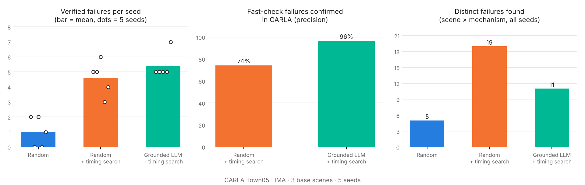
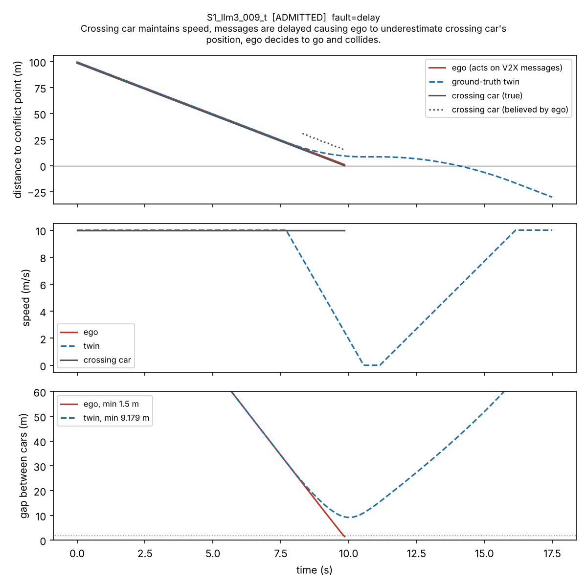

# Can LLMs Reason About *When* V2X Communication Fails? Grounded LLM Hypotheses for Safety Testing in CARLA

This is a small research prototype that asks whether a large language model (LLM) can act like a
transportation safety engineer: look at a connected-vehicle scenario, form **causal hypotheses** about
how wrong or missing V2X information could make a safety application fail, and find those failures in
simulation more effectively than random testing.

It builds on the evaluation idea of **LAST-V2X** (Wu, Zhang, Gan, Li, Jiang & Zhou, 2026, arXiv:2610.30979).
A failure counts only if the vehicle that acts on V2X messages crashes **and** an identical
*ground-truth twin* that receives perfect information stays safe. LAST-V2X keeps driver behavior
fixed. This project adds **behavioral uncertainty** and compares how different methods propose tests.



## Setup

- **Simulator:** CARLA 0.9.15, Town05, synchronous mode at 50 ms. The script automatically finds a junction with two straight, crossing movements.
- **Application:** Intersection Movement Assist (IMA), with decision logic following LAST-V2X Appendix D: a 3.5 s conflict window, a 0.5 s BSM age budget, 1 s reaction time and 3.5 m/s² braking.
- **V2X chain:** BSMs sent at 10 Hz, a 45 m radio range, then fault injection (`drop`, `delay`, `freeze`, `pos_perturb`), then the receiver's belief.
- **Causal check:** every scenario runs twice, as a V2X ego and as a ground-truth twin. It is **ADMITTED** only if the V2X ego crashes (center distance < 1.8 m) and the twin is safe.
- **Base scenes:** the crossing car arrives (S1) at about the same time as the ego, (S2) about 5 s later, or (S3) about 4.5 s earlier. S2 and S3 are non-conflicting at constant speed.

## Methods compared (same simulation budget)

| Method | Proposals | Timing search |
|---|---|---|
| `random` | random faults + random driver behavior | no |
| `random_hybrid` | random faults + random driver behavior | yes |
| `llm3` | GPT-4o causal hypotheses, grounded with a timeline, exact receiver rules and per-run feedback | yes |

Every simulation, including each timing-search step, counts toward the same budget (120 fast kinematic
checks per scene). The best 30 per scene are then verified in CARLA.

## Results (5 seeds, CARLA)

| Method | Verified failures / seed | Non-attributable / seed | Fast-check failures confirmed in CARLA | Distinct (scene × mechanism) failures |
|---|---|---|---|---|
| Random | 1 ± 1.0 | 0.2 | – | 5 |
| Random + timing search | 4.6 ± 1.14 | 2 | 23/31 | 19 |
| **Grounded LLM + timing search** | **5.4 ± 0.89** | **0.6** | **27/28** | 11 |

Verified failures by scene: Random + search {"S1": 8, "S2": 13, "S3": 2}; Grounded LLM + search {"S1": 24, "S2": 1, "S3": 2}.

### Findings

1. **An LLM alone did not beat random testing.** Plain GPT-4o (v1) found 0 verified failures in 90 runs, versus 2 for random. Its hypotheses sounded plausible but ignored timing: 85 of 90 faults started at t = 0, long before the vehicles were within radio range.
2. **Grounding fixed the reasoning, not the numbers.** Given a timeline, the exact receiver rules and simulation feedback (v2), GPT-4o targeted the true failure mechanism in **43%** of runs, versus 7% for v1 and 11–20% for random. It still found 0 failures, because a crash requires the vehicles to meet within about 0.1–0.2 s, which it never tuned.
3. **The true mechanism is "silent first contact."** Every verified failure has the same structure: the ego receives *no* message for the first ~2 s of radio contact (delay or drop). Since it never had a track of the crossing car, IMA assumes the junction is clear. When messages stop *after* contact, the stale-information fail-safe makes the ego stop instead. This is the *silent-by-absence* failure class described in LAST-V2X.
4. **Numeric timing search is the largest effect.** It gives about 5× more verified failures than random (consistent across all 5 seeds).
5. **LLM vs. random proposals, both with search: higher precision, lower coverage.** The LLM found a similar number of failures (5.4 vs 4.6 per seed; 2 wins, 2 ties and 1 loss, not a reliable difference with 5 seeds), but **96% vs 74%** of its fast-check failures held up in CARLA, with fewer non-attributable cases. It **explored less**: 11 vs 19 distinct failures, concentrated in one scene.

**In short:** grounded LLM reasoning understands *why* a V2X safety application fails and finds real failures precisely, but it needs numeric search to find *when*, and it under-explores.



*Example verified failure (kinematic replay of a CARLA-verified case). Messages are delayed at first contact, so the ego (red) never builds a track of the crossing car and drives on. The twin (blue) brakes and stays 9 m clear.*

## Open questions

- How can LLM causal reasoning be combined with **exploration** (for example, penalizing already-found mechanisms or reasoning about uncovered regions) so that testing is both precise and diverse?
- Do these results hold for **multi-vehicle scenarios, other applications (RLVW, LTA, EEBL), and real-world C-V2X channel data** instead of representative fault values?
- How should IMA-style applications handle **first contact**: is "no track yet" safely distinguishable from "no vehicle"?

## Limitations

This is a prototype. It covers one application (IMA), one junction and three base scenes. Vehicles are moved kinematically along CARLA map waypoints (physics off), and the collision rule is a 1.8 m center distance. Fault magnitudes are representative, not measured. The crossing car does not react to the ego. Five seeds are enough to show the large effects, not the small ones. The v2/v3 prompts include exact receiver rules (domain knowledge); an ablation without them is future work.

## Reproduce

Full setup (CARLA install, Python 3.7 environment, API key) is in [`docs/SETUP_AND_DEVELOPMENT.md`](docs/SETUP_AND_DEVELOPMENT.md).

```bash
# CARLA 0.9.15 server running; OPENAI_API_KEY set
python run_experiment.py --world carla --methods random random_hybrid llm3 --llm openai --model gpt-4o --budget 30 --screen 120 --seed 0
python analyze.py results/runs_carla_<timestamp>.jsonl
python summarize_seeds.py data/seed_runs/*.jsonl      # table + figure above
```
No GPU? Use `--world kinematic` to run the whole pipeline without CARLA.

## Repository layout

```
run_experiment.py        experiments (fixed, random, llm, llm2, random_screened, llm3, random_hybrid)
analyze.py               per-run summary table
summarize_seeds.py       multi-seed table + figure
plot_trace.py            V2X ego vs. ground-truth twin plot
v2xdemo/
  scenario.py physics.py messages.py ima.py runner.py   scenario, physics filter, V2X chain, IMA, paired causal check
  world_kinematic.py world_carla.py                     simulation worlds
  methods.py llm_agent.py agent_v2.py                   baselines, LLM v1, grounded LLM v2/v3 + timing search
data/seed_runs/          raw CARLA run logs for the 5 reported seeds
figures/                 figures in this README
```

## License

MIT. See [LICENSE](LICENSE).

## Author

Syeda Tamzida Akter · [syeda-tamzida.github.io](https://syeda-tamzida.github.io/)

## Reference

K. Wu, H. Zhang, R. Gan, P. Li, J. Jiang, Y. Zhou. *LAST-V2X: Language-Driven Adaptive Scenario Synthesis and Testing for Communication-Induced Failures in V2X Safety Applications.* arXiv:2610.30979, 2026.
